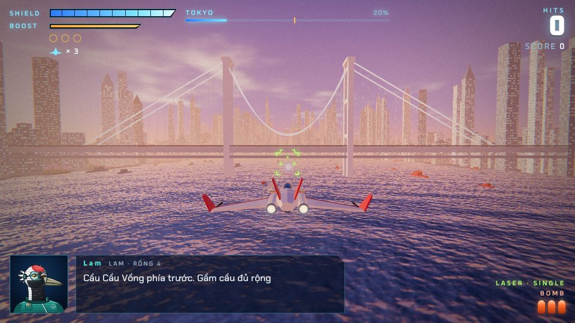
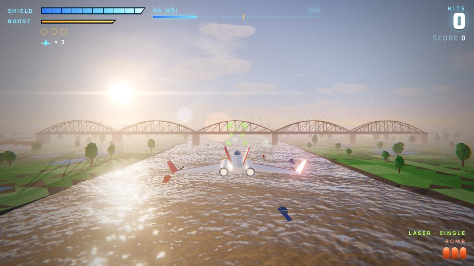
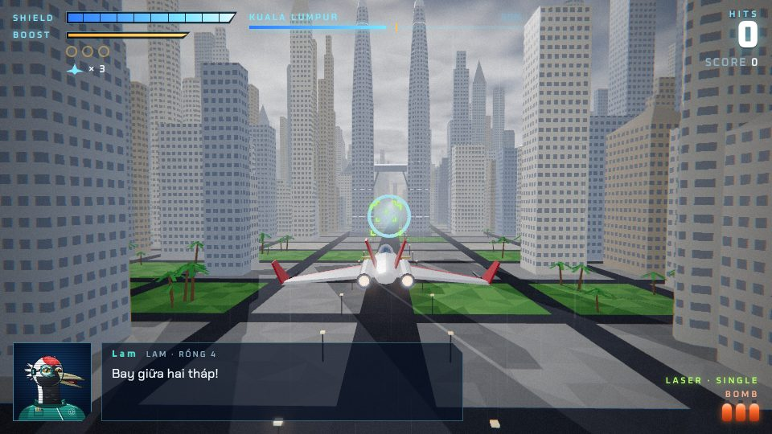
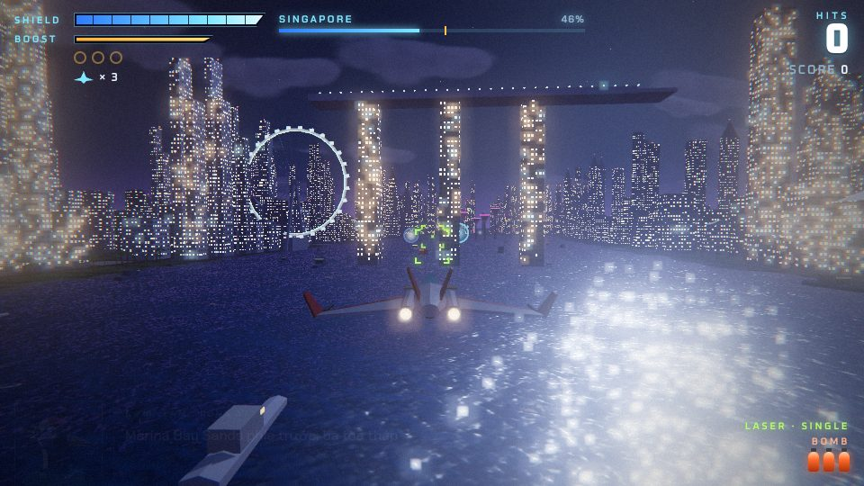
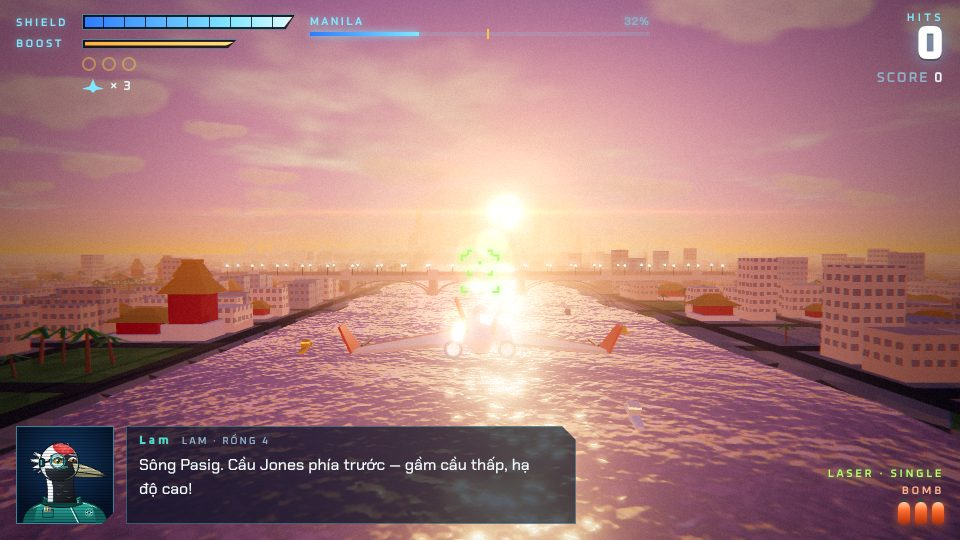
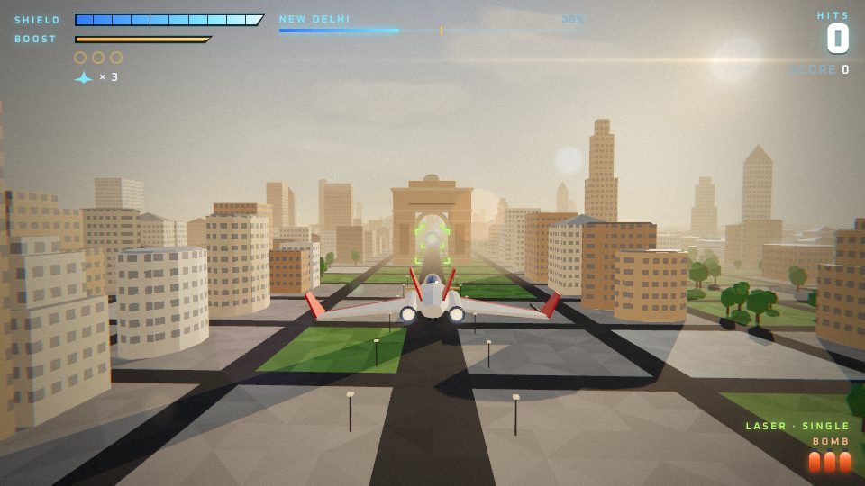
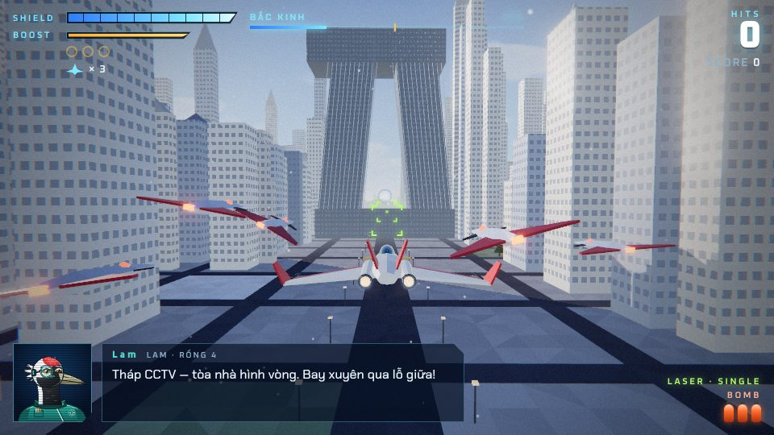
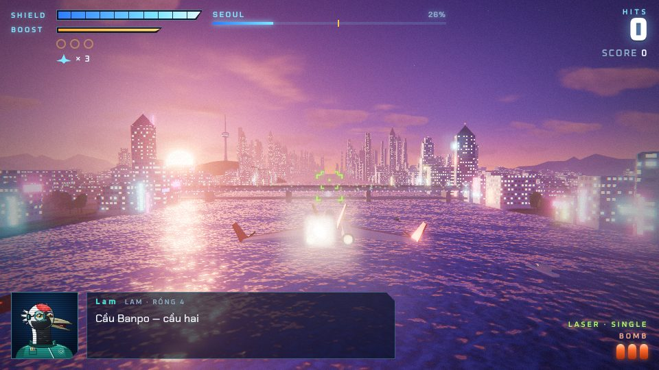
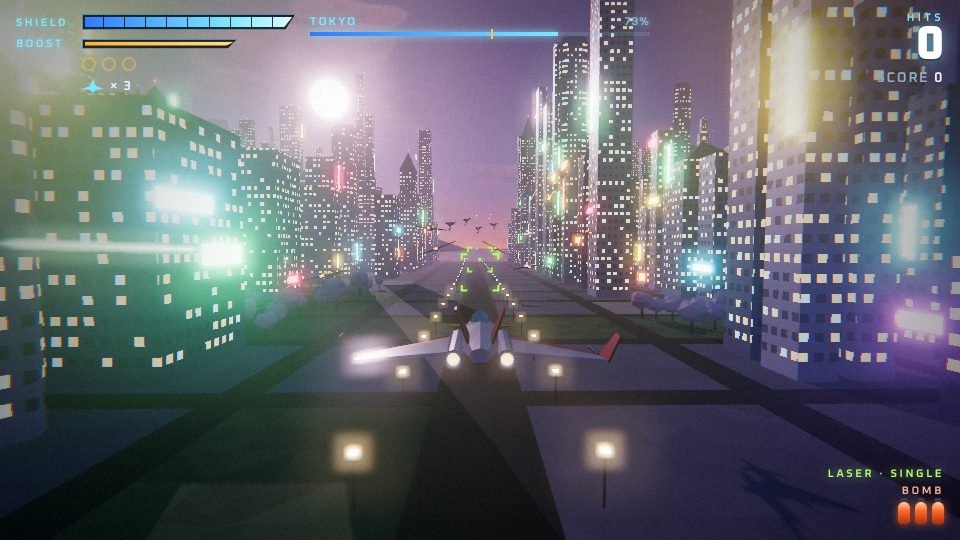
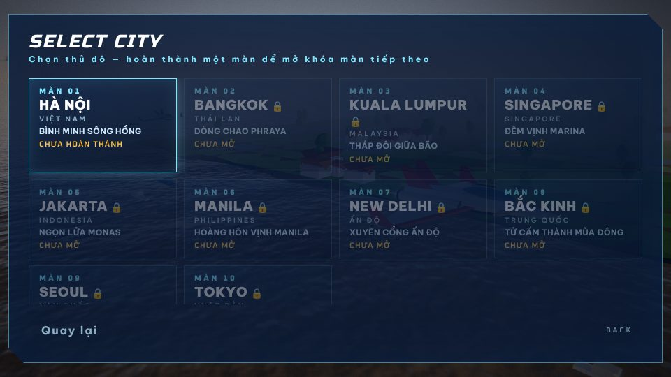

# SKYLINE ASIA — Phi Đội Rồng · 10 Thủ Đô



Game bắn máy bay 3D theo đường ray (kiểu Star Fox) chạy trên trình duyệt, viết mới dựa trên engine của [NOVA LANCER](../README.md).
Phi đội Rồng bay qua bầu trời **10 thủ đô châu Á** để đánh bật quân đoàn máy móc Hắc Vân. Địa hình, thành phố, công trình biểu tượng, boss, nhạc nền và giọng nói đều được **tạo hoàn toàn bằng mã** (Three.js + Web Audio), không có một tệp ảnh hay âm thanh nào.

**Chơi:** mở `asia/index.html` trong trình duyệt (một tệp duy nhất, chạy offline; chỉ font chữ tải từ Google Fonts). Khi bật GitHub Pages cho repo, đường dẫn là `…/asia/`.

| | |
| --- | --- |
|  |  |
|  |  |
|  |  |
|  |  |

## 10 màn chơi

| # | Thủ đô | Tên màn | Thời điểm | Công trình nổi bật (bay xuyên/qua để ăn điểm thưởng) | Boss |
| --- | --- | --- | --- | --- | --- |
| 1 | **Hà Nội** (Việt Nam) | Bình Minh Sông Hồng | Bình minh, sương sớm | Cầu Long Biên (bay gầm cầu), Hồ Gươm – Tháp Rùa – cầu Thê Húc, Cột Cờ, Keangnam Landmark 72, Lotte Center | LONG XÀ-01 — mãng xà cơ khí trên Hồ Tây |
| 2 | **Bangkok** (Thái Lan) | Dòng Chao Phraya | Chiều vàng | Wat Arun, Hoàng cung, cầu dây văng Rama VIII, tháp MahaNakhon | NAGA-X — rắn thần thép |
| 3 | **Kuala Lumpur** (Malaysia) | Tháp Đôi Giữa Bão | Giông nhiệt đới, mưa, sấm chớp | Tháp đôi Petronas (bay giữa hai tháp, trên/dưới cầu nối), tháp KL, Merdeka 118 | THUNDERHEAD — chiến hạm bão tố |
| 4 | **Singapore** | Đêm Vịnh Marina | Đêm, đèn neon | Marina Bay Sands (2 khe giữa 3 tòa), rừng siêu cây Gardens by the Bay, vòng quay Singapore Flyer | NEON EYE — pháo đài mắt neon |
| 5 | **Jakarta** (Indonesia) | Ngọn Lửa Monas | Sáng mờ sương | Tượng đài Monas, Wisma 46, đại lộ Sudirman | KRAKATOA — chiến hạm núi lửa |
| 6 | **Manila** (Philippines) | Hoàng Hôn Vịnh Manila | Hoàng hôn → chạng vạng | Cầu Jones trên sông Pasig, cổng thành cổ Intramuros, tàu container trên vịnh | LEVIATHAN — thủy quái vịnh Manila |
| 7 | **New Delhi** (Ấn Độ) | Xuyên Cổng Ấn Độ | Nắng vàng bụi mờ | Cổng Ấn Độ (bay xuyên vòm), lăng Humayun, tháp Qutub Minar | SANDSTORM — chiến hạm bão cát |
| 8 | **Bắc Kinh** (Trung Quốc) | Tử Cấm Thành Mùa Đông | Mùa đông, tuyết | Tháp CCTV (bay xuyên lỗ), Ngọ Môn, Thái Hòa Điện, Thiên Đàn, Vạn Lý Trường Thành trên núi tuyết | BLIZZARD CORE — lõi bão tuyết |
| 9 | **Seoul** (Hàn Quốc) | Đêm Sông Hán | Chạng vạng → đêm | Cầu Banpo (khe giữa 2 tầng cầu, đài phun cầu vồng), tháp Namsan, Lotte World Tower, cổng Gwanghwamun | IMUGI-9 — mãng xà sông Hán |
| 10 | **Tokyo** (Nhật Bản) | Trận Chiến Cuối Cùng | Hoàng hôn → đêm, núi Phú Sĩ phía xa | Cầu Cầu Vồng, tháp Tokyo, Skytree, Shibuya neon, hoa anh đào | HẮC VÂN — kỳ hạm tối thượng |

Mỗi màn có bảng màu bầu trời riêng (đổi dần theo thời gian bay), địa hình riêng (ruộng lúa, sông, vịnh, núi tuyết, lưới phố với nhà cao tầng – nhà ống – mái cung điện), nhạc nền riêng mang âm hưởng quốc gia đó, và lời thoại tiếng Việt của phi đội. Công trình biểu tượng là thứ phi đội **bảo vệ**: chúng không bao giờ bị phá hủy hay bị nhắm bắn, chỉ là chướng ngại để luồn lách và ăn điểm thưởng.



## Cách chơi

- **Chiến dịch**: bay lần lượt 10 thủ đô; mạng, vũ khí, bom và điểm được giữ qua các màn. Hoàn thành một màn sẽ mở khóa màn tiếp theo (lưu trong trình duyệt). Có thể **chọn thủ đô** đã mở để chơi lại.
- Mỗi màn có **điểm kiểm tra** ở giữa đường, rồi một **boss** ở cuối. Ba kiểu boss, mỗi màn một phối màu, kích thước, độ bền và đòn đánh khác nhau:
  - **Mãng xà** (Hà Nội, Bangkok, Manila, Seoul): trồi lên từ mặt nước, phá các tháp pháo trên lưng rồi bắn lõi trong miệng khi nó há ra.
  - **Chiến hạm** (Kuala Lumpur, Jakarta, New Delhi, Tokyo): hạ tháp pháo trên boong, rồi bắn lõi năng lượng khi cửa mũi tàu mở; kỳ hạm Tokyo bắn hai tia cùng lúc khi nổi điên.
  - **Pháo đài lõi** (Singapore, Bắc Kinh): phá vòng tấm khiên xoay, rồi bắn "con mắt" khi vỏ mở.
- Độ khó tăng dần theo từng thủ đô (địch bắn dày hơn, đạn nhanh hơn, địch lớn bền hơn), cộng với 3 mức độ khó tự chọn.
- Có sự kiện **giải cứu đồng đội** (Bông ở Hà Nội, Thạch ở Manila, Lam ở Bắc Kinh), vòng bạc hồi khiên, vòng vàng tăng khiên tối đa / thêm mạng, laser đôi → laser siêu cấp, bom thông minh, tàu chiến cỡ lớn, cổng năng lượng, thủy lôi.
- Kết thúc mỗi màn có bảng điểm và xếp hạng S/A/B/C; hoàn thành Tokyo sẽ mở màn kết thúc chiến dịch với tổng điểm của cả 10 thủ đô.

### Phi đội Rồng

| Nhân vật | Vai trò |
| --- | --- |
| **Bông** (rái cá) | Rồng 2 — trẻ, hăng hái, hay nói |
| **Thạch** (trâu nước) | Rồng 3 — phi công kỳ cựu, ít lời |
| **Lam** (sếu đầu đỏ) | Rồng 4 — hoa tiêu, kỹ sư, phân tích chiến trường |
| **Tướng Hổ** (hổ Đông Dương) | Chỉ huy |
| **Hắc Vân** | Trí tuệ máy của quân đoàn xâm lược |

### Điều khiển

| Thao tác | Bàn phím | Tay cầm |
| --- | --- | --- |
| Di chuyển | W A S D / phím mũi tên | Cần trái / D-pad |
| Bắn (giữ để nạp → thả: đạn khóa mục tiêu) | J / Space / Z / chuột trái | A |
| Bom thông minh (nhấn lần nữa để nổ ngay) | K / B / X / chuột phải | B / Y |
| Tăng tốc | L / Shift / C | R2 |
| Phanh | I / V | L2 / X |
| Lộn vòng gạt đạn (nhấn nhanh 2 lần; giữ để nghiêng cánh) | Q / E | L1 / R1 |
| Tạm dừng | Esc / P | Start |

Trên điện thoại: kéo ở góc trái dưới để di chuyển, các nút bên phải để bắn, bom, tăng tốc, phanh, lộn vòng.

## Phát triển

```bash
npm install
npm run build:asia   # tạo asia/index.html (một tệp, có sẵn three.js)
npm run dev:asia     # bản dev có sourcemap, tự build lại khi sửa mã
```

Bản dev có thêm công cụ kiểm thử trong console: `__stage(n)` (vào màn n), `__jump(d, n)` (nhảy tới quãng đường d của màn n), `__step(frames)`, `__bot(frames)` (lái tự động bắn địch / boss). Với `G.frozen = true` vòng lặp tự động dừng để kiểm thử từng khung hình.

| Tệp (`asia/src/`) | Nội dung |
| --- | --- |
| `stages.js` | Dữ liệu 10 màn: bầu trời, địa hình, công trình, kịch bản địch, lời thoại, boss |
| `world.js` | Địa hình theo đoạn (ruộng, sông, vịnh, núi, phố), nhà cao tầng – neon – đèn đường – cây – thuyền, mặt nước, mây, bảng màu |
| `landmarks.js` | 37 công trình biểu tượng dựng bằng khối hình học, kèm vùng va chạm và "cổng" ăn điểm |
| `level.js` | Chạy kịch bản màn chơi, các đợt địch, sự kiện giải cứu |
| `serpent.js` / `warship.js` / `coreboss.js` / `boss.js` | Ba kiểu boss và bộ quản lý boss |
| `main.js` | Luồng chiến dịch, chọn màn, kết quả, kết thúc, thời tiết (mưa, tuyết, sấm) |
| `audio.js` | Nhạc 16 bài (title, 10 màn, boss, boss cuối, clear, game over, ending) và giọng nói tiếng Việt tổng hợp |
| `portraits.js` | Chân dung SVG của Bông, Thạch, Lam, Tướng Hổ, Hắc Vân |
| `hud.js`, `template.html` | HUD, menu, chọn thủ đô, thanh tiến độ, màn kết thúc (tiếng Việt) |
| còn lại | Engine dùng chung từ NOVA LANCER (máy bay, vũ khí, địch, hiệu ứng, đồ họa) |

## Ghi chú

- Tất cả công trình là mô hình đơn giản hóa, chỉ gợi hình dáng; tỉ lệ được điều chỉnh để phục vụ lối chơi.
- Giai điệu nhạc đều là sáng tác mới mô phỏng âm hưởng từng quốc gia (ngũ cung Việt, gamelan, raga, ngũ cung Trung Hoa, miyako-bushi…), không dùng bài hát hay quốc ca có sẵn.
- Mã nguồn: MIT License (xem [LICENSE](../LICENSE)). Three.js: MIT. Font: Be Vietnam Pro, Chakra Petch, Oxanium, Russo One (SIL Open Font License).
