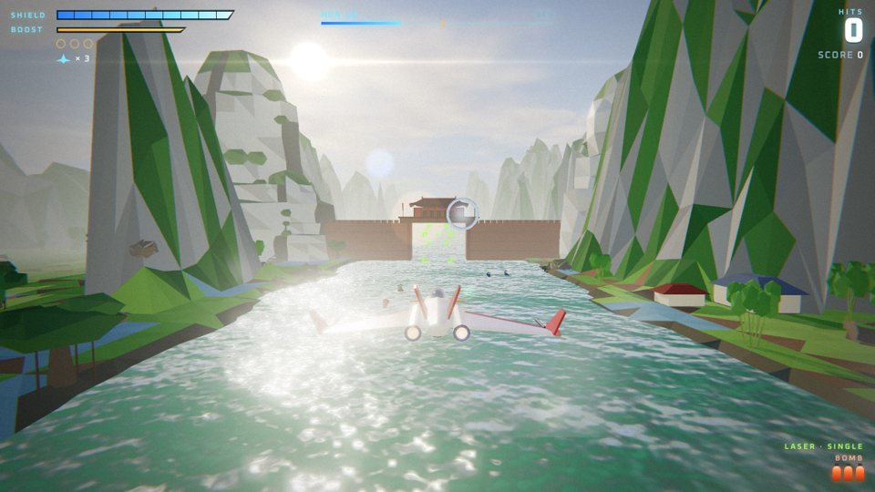
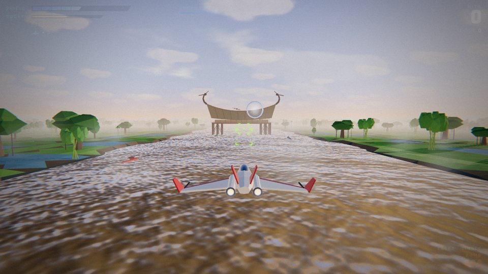
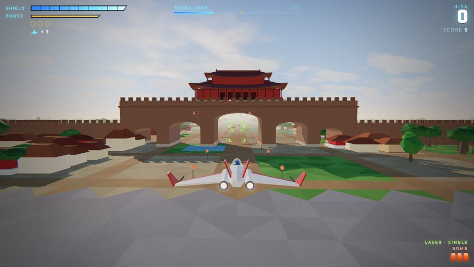
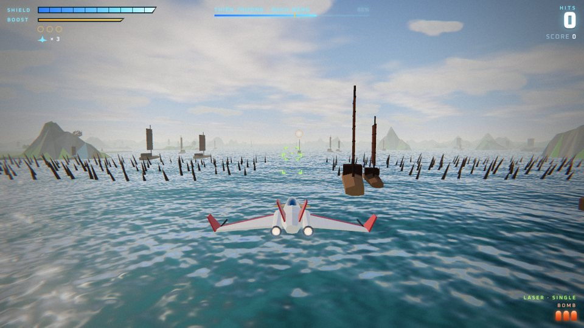
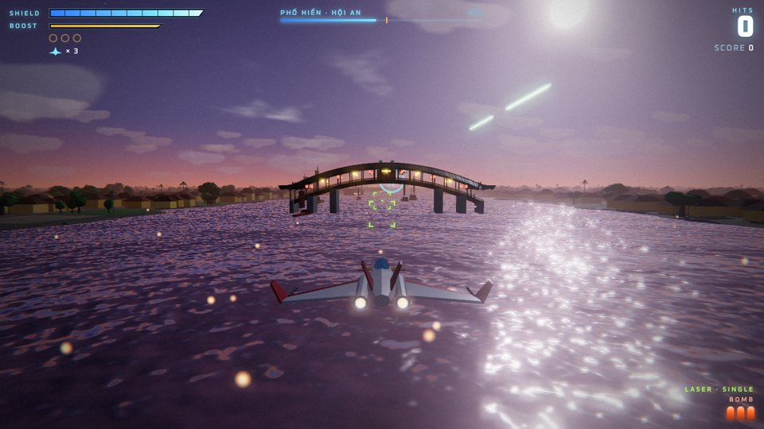

# LẠC HỒNG · NGHÌN NĂM — Phi đội xuyên thời gian



Game không chiến 3D theo đường ray (kiểu Star Fox) chạy trên trình duyệt, viết mới dựa trên engine của [NOVA LANCER](../README.md), [SKYLINE ASIA](../asia/README.md) và [PANDORA RIDERS](../pandora/README.md).
**Phi đội Lạc Hồng** nhảy qua **10 thời kỳ hoàng kim** của lịch sử Việt Nam, từ nước Văn Lang của các vua Hùng đến kinh thành Huế triều Nguyễn. Ở mỗi thời kỳ, phi đội ngắm kinh thành, kiến trúc và cảnh quan thời ấy, đồng thời bảo vệ chúng khỏi **Thời Ảnh**, một quân đoàn máy bóng tối muốn xóa lịch sử. Hoa tiêu **Sử** thuyết minh về từng di tích qua bộ đàm.

Địa hình, công trình, máy bay, boss, nhạc nền và giọng nói đều được **tạo hoàn toàn bằng mã** (Three.js + Web Audio), không dùng tệp ảnh hay âm thanh nào.

**Chơi:** mở `lachong/index.html` trong trình duyệt (một tệp duy nhất, chạy offline; chỉ font chữ tải từ Google Fonts). **Cả 10 màn đều chọn chơi được ngay từ đầu** (menu *Chọn thời kỳ*), hoặc chơi cả chiến dịch theo thứ tự thời gian.

| | |
| --- | --- |
|  |  |
|  |  |

## 10 thời kỳ

| # | Thời kỳ | Kinh đô / nơi bay | Cảnh quan | Di tích (dựng lại giản lược) | Boss |
| --- | --- | --- | --- | --- | --- |
| 1 | **Văn Lang** — các vua Hùng (TK VII TCN) | Phong Châu | Bình minh trên đồi trung du, ngã ba sông, làng nhà sàn, lũy tre | Núi Nghĩa Lĩnh, nhà sàn mái cong (bay gầm sàn), trống đồng Đông Sơn, thuyền chiến Lạc Việt | THỦY TINH ẢNH (mãng xà nước) |
| 2 | **Âu Lạc** — An Dương Vương (TK III TCN) | Cổ Loa | Đồng bằng, hào nước, làng nhà sàn | Ba vòng thành Cổ Loa (bay xuyên ba cổng), chòi nỏ, đền Thượng – Giếng Ngọc | HẮC NỎ (pháo đài lõi) |
| 3 | **Đại Cồ Việt** — Đinh · Tiền Lê (968–1009) | Hoa Lư | Núi đá vôi giữa sông và ruộng, sương sớm | Tường thành nối hai núi đá, đền vua Đinh, cột kinh Phật (973), cung điện dát vàng | LÂU THUYỀN ẢNH (chiến hạm) |
| 4 | **Lý** (1010–1225) | Thăng Long | Sông Hồng, kinh thành mái ngói, vườn và ao sen, hoàng hôn trên Hồ Tây | Cổng hoàng thành, tháp Báo Thiên (1057), chùa Một Cột (1049), điện chính, Văn Miếu (1070) | GIAO LONG ẢNH (mãng xà) |
| 5 | **Trần** (1225–1400) | Thiên Trường · Bạch Đằng | Đồng bằng Nam Định → đồi núi Yên Tử → cửa sông, giông | Cung Thiên Trường, tháp Phổ Minh (1305), núi Yên Tử, bãi cọc Bạch Đằng 1288 (bay luồn giữa cọc), chiến thuyền | THỦY QUÁI TRIỀU ĐEN (mãng xà) |
| 6 | **Hồ** (1400–1407) | Tây Đô | Mưa phùn xứ Thanh | Cổng Nam thành Tây Đô bằng đá khối (1397), đàn Nam Giao (1402) | THÀNH ĐÁ ẢNH (pháo đài lõi) |
| 7 | **Lê sơ** — thời Hồng Đức (1428–1527) | Lam Kinh · Đông Kinh | Từ quê Lam Sơn về kinh thành, chiều muộn | Lam Kinh, rùa vàng hồ Hoàn Kiếm, điện Kính Thiên (rồng đá 1467), vườn bia tiến sĩ (1484) | KỲ HẠM HẮC KIẾM (chiến hạm) |
| 8 | **Thương cảng** (TK XVI–XVII) | Phố Hiến · Hội An | Sông nước lúc hoàng hôn rồi đêm, đèn lồng | Văn Miếu Xích Đằng, tàu buồm Hà Lan, Châu ấn thuyền Nhật Bản, dãy phố Hội An, chùa Cầu (bay gầm cầu), hội quán Phúc Kiến | THUYỀN MA (chiến hạm) |
| 9 | **Tây Sơn** (1771–1802) | Quy Nhơn → Thăng Long | Đầm Thị Nại, đồng bằng, mùa xuân hoa đào | Tháp Đôi, Hoàng Đế thành, tháp Cánh Tiên, voi chiến, gò Đống Đa (Tết Kỷ Dậu 1789) | LÕI BÃO ĐÊM (pháo đài lõi) |
| 10 | **Nguyễn** (1802–1945) | Phú Xuân · Huế | Sông Hương, kinh thành mái vàng, hoàng hôn | Chùa Thiên Mụ, thuyền rồng, cổng kinh thành, Kỳ Đài, Ngọ Môn (bay cửa giữa), điện Thái Hòa, Hiển Lâm Các – Cửu Đỉnh, lăng Minh Mạng | THỜI ẢNH VƯƠNG (kỳ hạm cuối) |

Địa hình có các kiểu mới viết riêng cho game này: **đồi trung du**, **núi đá vôi** (Hoa Lư – Tràng An), **làng nhà sàn**, **kinh thành nhà ngói** có vườn và ao sen, **phố cổ**, cùng cây tre, cau, đa, đào, thuyền nan và thuyền buồm. Di tích là thứ phi đội **bảo vệ**: chúng không bao giờ bị phá hủy hay bị nhắm bắn. Nhiều di tích cho bay xuyên qua để ăn điểm thưởng, như gầm nhà sàn, cổng thành Cổ Loa, Hoa Lư, Đoan Môn, Tây Đô, Hoàng Đế thành, gầm chùa Cầu và cửa giữa Ngọ Môn.

## Phi đội

| Nhân vật | Vai trò |
| --- | --- |
| **Âu** | Lạc Hồng 2: nữ phi công trẻ, hăng hái |
| **Đồng** | Lạc Hồng 3: phi công kỳ cựu, điềm tĩnh |
| **Sử** | Lạc Hồng 4: hoa tiêu kiêm sử gia, thuyết minh các di tích |
| **Chỉ huy Kiên** | Chỉ huy ở trạm thời gian |
| **Thời Ảnh** | Trí tuệ máy bóng tối, muốn xóa lịch sử |

## Cách chơi

- Có điểm kiểm tra giữa màn, boss ở cuối màn, bảng điểm và xếp hạng S/A/B/C. Hoàn thành Huế trong chế độ chiến dịch sẽ mở màn kết thúc.
- Ba kiểu boss:
  - **Mãng xà**: phá tháp pháo trên lưng, rồi bắn lõi trong miệng.
  - **Chiến hạm**: phá tháp pháo trên boong, rồi bắn lõi khi cửa hầm mở.
  - **Pháo đài lõi**: phá vòng khiên, rồi bắn "con mắt".
- Ngoài ra có vòng bạc hồi khiên, vòng vàng, laser đôi và laser siêu cấp, bom thông minh, và sự kiện giải cứu đồng đội.

### Điều khiển

| Thao tác | Bàn phím | Tay cầm |
| --- | --- | --- |
| Di chuyển | W A S D / phím mũi tên | Cần trái / D-pad |
| Bắn (giữ để nạp → thả: đạn khóa mục tiêu) | J / Space / Z / chuột trái | A |
| Bom thông minh | K / B / X / chuột phải | B / Y |
| Tăng tốc / Phanh | L / Shift / C · I / V | R2 · L2 |
| Lộn vòng gạt đạn (nhấn nhanh 2 lần) | Q / E | L1 / R1 |
| Tạm dừng | Esc / P | Start |

## Phát triển

```bash
npm install
npm run build:lachong   # tạo lachong/index.html (một tệp, có sẵn three.js)
npm run dev:lachong     # bản dev có sourcemap, tự build lại khi sửa mã
```

| Tệp (`lachong/src/`) | Nội dung |
| --- | --- |
| `stages.js` | 10 thời kỳ: bầu trời, địa hình, di tích, lời thuyết minh, địch, boss |
| `world.js` | Địa hình theo đoạn: đồi trung du, núi đá vôi, đồng ruộng, sông, kinh thành, phố cổ; nhà sàn, nhà ngói, cây và thuyền |
| `lmkit.js` | Bộ dựng hình: mái cong đầu đao, nhà nhiều tầng mái, tháp nhiều tầng, tường thành |
| `landmarks_a.js` / `landmarks_b.js` | Di tích thời kỳ 1–5 và 6–10 |
| `audio.js` | Nhạc nền mỗi thời kỳ (sáo trúc, đàn tranh, đàn bầu, trống đồng, nhã nhạc…) và giọng nói tổng hợp |
| `portraits.js` | Chân dung SVG của phi đội |
| còn lại | Engine dùng chung (máy bay, vũ khí, địch, boss, hiệu ứng, HUD) |

## Ghi chú lịch sử

- Di tích được dựng lại **giản lược và phóng to** để nhìn được từ máy bay, dựa trên những gì sử liệu và khảo cổ ghi nhận. Nhiều công trình nay không còn (tháp Báo Thiên, cung điện Hoa Lư, điện Kính Thiên…), nên hình dáng trong game chỉ có tính gợi tả.
- Chuyện "rồng vàng", "nỏ thần", "rùa vàng trả gươm" được thuyết minh như **truyền thuyết**. Phi đội, Thời Ảnh và các trận đánh trên không đều là hư cấu.
- Nhạc là sáng tác mới mô phỏng màu sắc âm nhạc truyền thống, không dùng bài dân ca hay nhã nhạc có sẵn.
- Mã nguồn: MIT License (xem [LICENSE](../LICENSE)). Three.js: MIT. Font: Be Vietnam Pro, Chakra Petch, Oxanium (SIL Open Font License).
