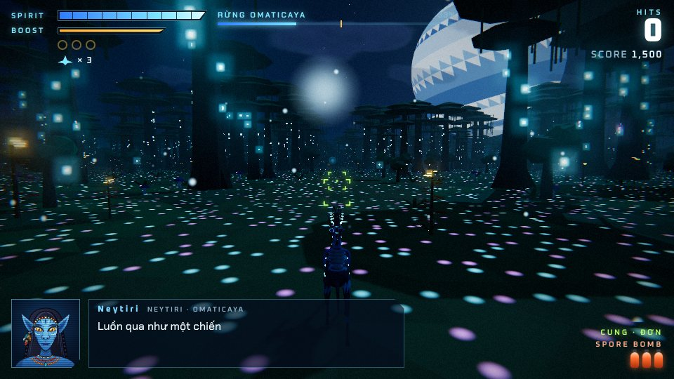
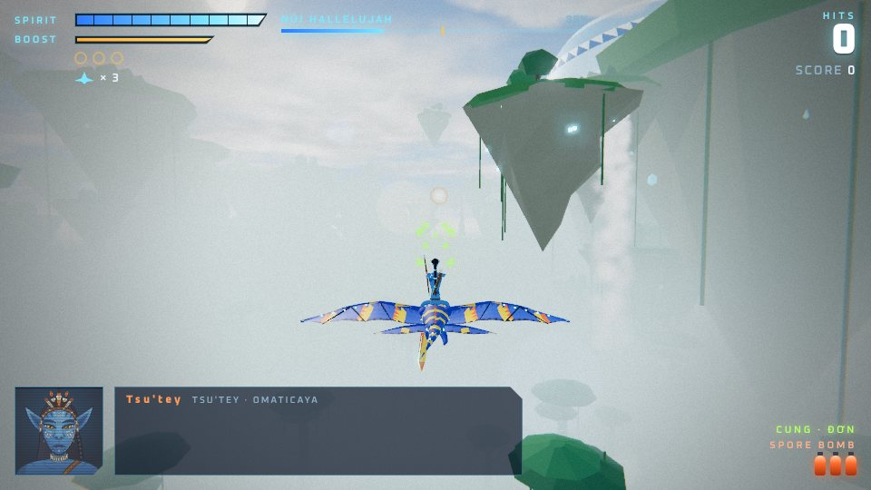
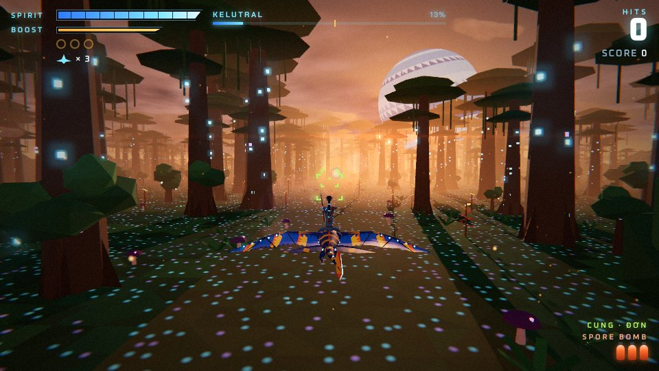
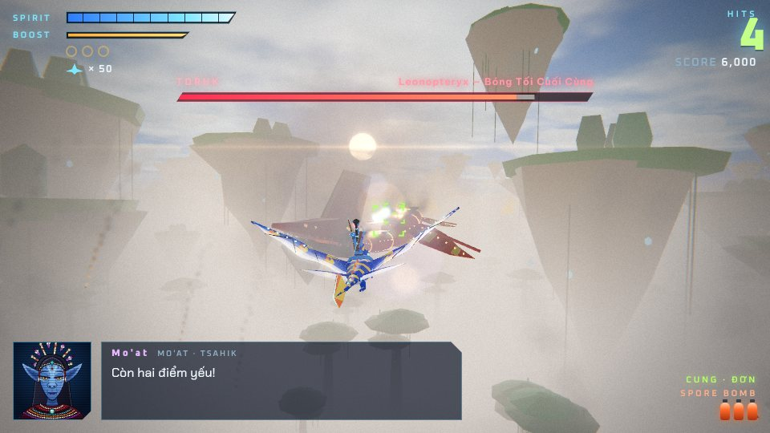
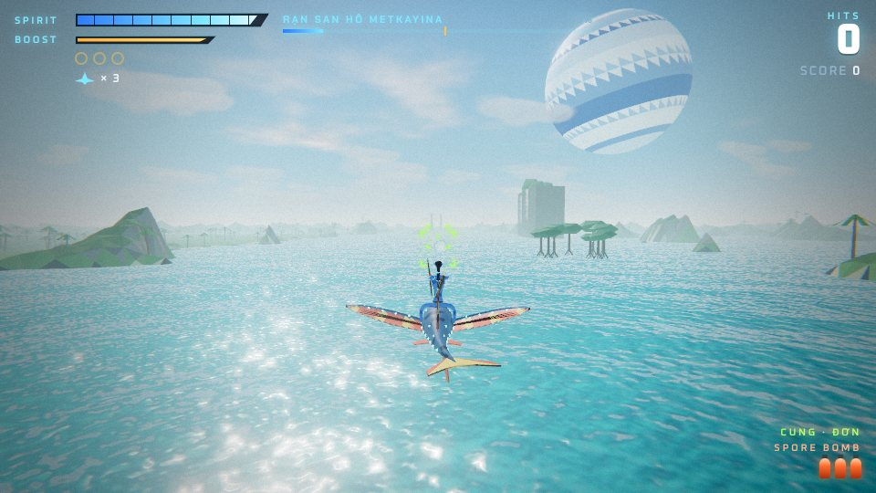

# PANDORA RIDERS — Kỵ Sĩ Pandora · 10 màn



Game bắn súng 3D theo đường ray (kiểu Star Fox) chạy trên trình duyệt, viết mới dựa trên engine của [NOVA LANCER](../README.md) và [SKYLINE ASIA](../asia/README.md).
Người chơi **cưỡi thú chiến đấu** — pa'li, ikran, Toruk, thanator, skimwing — qua **10 màn trên hành tinh Pandora**, mỗi màn một địa hình riêng và bám theo cốt truyện hai phim *Avatar* (2009) và *Avatar: The Way of Water* (2022). Địa hình, sinh vật, cỗ máy, boss, nhạc nền và giọng nói đều được **tạo hoàn toàn bằng mã** (Three.js + Web Audio), không có tệp ảnh hay âm thanh nào.

> **Game hâm mộ, phi thương mại.** Dự án không liên kết, không được tài trợ hay chấp thuận bởi Disney, 20th Century Studios hay Lightstorm Entertainment. "Avatar", "Pandora" và tên nhân vật thuộc về chủ sở hữu tương ứng. Mọi lời thoại, giai điệu, mô hình 3D và hình vẽ trong game đều là sáng tác mới; không dùng thoại, nhạc hay hình ảnh từ phim.

**Chơi:** mở `pandora/index.html` trong trình duyệt (một tệp duy nhất, chạy offline; chỉ font chữ tải từ Google Fonts). Khi bật GitHub Pages cho repo, đường dẫn là `…/pandora/`.

| | |
| --- | --- |
|  |  |
|  |  |

## 10 màn chơi

| # | Màn | Địa hình | Thú cưỡi | Đồng đội | Boss |
| --- | --- | --- | --- | --- | --- |
| 1 | **Đêm Đầu Tiên** — lạc trong rừng, Neytiri dẫn đường | Rừng Omaticaya về đêm, rêu phát quang, hạt giống thiêng bay lơ lửng | Pa'li | Neytiri | **Palulukan** (thanator) — khuất phục, không giết |
| 2 | **Cưỡi Pa'li** — học cưỡi, chặn máy ủi | Thảo nguyên → rừng thiêng → vết rừng bị cạo trụi của RDA | Pa'li | Neytiri, Tsu'tey | **Máy xúc D-9** |
| 3 | **Iknimaya** — thử thách trưởng thành | Núi Hallelujah: đảo bay, thác nước, cầu dây leo, cột đá | Ikran | Neytiri, Tsu'tey | **Ikran hoang** đầu đàn — thuần phục |
| 4 | **Cây Nhà Bốc Cháy** | Rừng ngập khói lửa lúc chạng vạng, Cây Nhà đang cháy | Ikran | Neytiri, Tsu'tey | **Dragon** — chiến hạm của Quaritch |
| 5 | **Toruk Makto** | Bầu trời trên mây, núi bay | Ikran | Neytiri | **Toruk** — Bóng Tối Cuối Cùng, thuần phục |
| 6 | **Vùng Xoáy Từ Trường** | Vùng Flux: đá bay xoay vòng, bão sét xanh | **Toruk** (đồng đội cưỡi ikran) | Neytiri, Tsu'tey | **Valkyrie** chở bom |
| 7 | **Cây Linh Hồn** | Rừng lúc hoàng hôn → đêm, Cây Linh Hồn | **Thanator** | Neytiri | **Quaritch** trong bộ giáp AMP |
| 8 | **Đoàn Tàu Thép** — nhiều năm sau | Đường ray xuyên rừng và thảo nguyên | Ikran | Neytiri, Neteyam | **Đoàn tàu bọc thép** chạy trên ray |
| 9 | **Đường Của Nước** | Rạn san hô Metkayina, rừng đước, vách đá, tulkun | **Skimwing** | Neytiri, Neteyam | **Tàu săn tulkun** |
| 10 | **Trận Chiến Trên Biển** | Vịnh ngoài khơi, ngày → hoàng hôn | Skimwing | Neytiri, Neteyam | **SeaDragon** — kỳ hạm của RDA |

Ba màn có **boss là sinh vật** (thanator, ikran hoang, Toruk): phá các mảng giáp phát sáng trên lưng, rồi bắn vào "trái tim" khi nó há miệng. Hết máu, sinh vật **không chết** mà chịu khuất phục rồi bỏ đi. Bảy màn còn lại là **cỗ máy RDA** (máy xúc, chiến hạm Dragon, Valkyrie, bộ giáp AMP, đoàn tàu, tàu săn, SeaDragon): hạ ụ pháo, rồi bắn lõi năng lượng khi cửa khoang mở.

Mỗi màn có bầu trời đổi dần theo thời gian, địa hình riêng (rừng, thảo nguyên, vết rừng bị phá, núi bay, rạn san hô, biển), kiểu địch riêng (bầy dơi gai và ikran hoang; trực thăng Scorpion/Samson, drone, AMP, tháp pháo của RDA; xuồng máy và pháo nổi trên biển), nhạc nền riêng và lời thoại tiếng Việt.

## Cách chơi

- **Chiến dịch** 10 màn; mạng, cung, bào tử nổ và điểm được giữ qua các màn. Hoàn thành một màn sẽ mở khóa màn tiếp theo (lưu trong trình duyệt). Có thể **chọn màn** đã mở để chơi lại.
- **Thú bay** (ikran, Toruk) bay tự do trong khoảng cao 0–58 m. **Skimwing** lướt sát mặt biển (tối đa 28 m). **Thú chạy** (pa'li, thanator) chạy trên mặt đất: giữ phím lên để **nhảy vọt** (tối đa 20 m), thả ra để đáp xuống; lộn mình biến thành cú **né ngang**.
- Bắn tên phát sáng; giữ nút bắn để căng dây rồi thả ra bắn chùm tên khóa mục tiêu. Nhặt bào tử để có **tên đôi → cung thần**. **Bào tử nổ** (bom) dọn sạch màn hình.
- Vòng bào tử bạc hồi sức, 3 hạt giống vàng tăng sức tối đa / thêm mạng. Luồn qua vòm rễ, cầu dây leo và khe đá để ăn điểm thưởng.
- Sự kiện **giải cứu đồng đội** (Neteyam ở màn đoàn tàu), điểm kiểm tra giữa màn, bảng điểm và xếp hạng S/A/B/C cuối màn, màn kết thúc với tổng điểm cả chiến dịch.

### Nhân vật (chân dung SVG vẽ bằng mã)

| Nhân vật | Vai trò |
| --- | --- |
| **Jake** | Người chơi |
| **Neytiri** | Đồng đội — dẫn đường từ đêm đầu tiên |
| **Tsu'tey** | Đồng đội — chiến binh kiêu hãnh của tộc |
| **Neteyam** | Đồng đội — con trai cả nhà Sully (phần III) |
| **Mo'at**, **Grace**, **Norm**, **Tonowari** | Giọng nói từ hậu phương theo từng màn |
| **Quaritch** | Chỉ huy RDA |

### Điều khiển

| Thao tác | Bàn phím | Tay cầm |
| --- | --- | --- |
| Di chuyển (thú chạy: lên = nhảy) | W A S D / phím mũi tên | Cần trái / D-pad |
| Bắn tên (giữ để căng dây → thả: tên khóa mục tiêu) | J / Space / Z / chuột trái | A |
| Bào tử nổ (nhấn lần nữa để nổ ngay) | K / B / X / chuột phải | B / Y |
| Phi nhanh | L / Shift / C | R2 |
| Ghìm cương | I / V | L2 / X |
| Lộn mình gạt đạn (nhấn nhanh 2 lần; giữ để nghiêng) | Q / E | L1 / R1 |
| Tạm dừng | Esc / P | Start |

Trên điện thoại: kéo ở góc trái dưới để di chuyển, các nút bên phải để bắn, bom, phi nhanh, ghìm cương, lộn mình.

## Phát triển

```bash
npm install
npm run build:pandora   # tạo pandora/index.html (một tệp, có sẵn three.js)
npm run dev:pandora     # bản dev có sourcemap, tự build lại khi sửa mã
```

Bản dev có công cụ kiểm thử trong console: `__stage(n)`, `__jump(d, n)`, `__step(frames)`, `__bot(frames)` (lái tự động). Với `G.frozen = true` vòng lặp tự động dừng để kiểm thử từng khung hình.

| Tệp (`pandora/src/`) | Nội dung |
| --- | --- |
| `stages.js` | Dữ liệu 10 màn: bầu trời, địa hình, thú cưỡi, đồng đội, công trình, kịch bản địch, lời thoại, boss |
| `mounts.js` | 5 loài thú cưỡi (mỗi con một skinned mesh có xương, hoạt ảnh vỗ cánh / phi nước đại / quẫy đuôi) và 4 kỵ sĩ Na'vi |
| `world.js` | Địa hình theo đoạn (rừng, thảo nguyên, vết rừng bị phá, núi bay, biển), cây khổng lồ, dương xỉ, helicoradian, nấm phát quang, đảo bay, rêu phát sáng ban đêm |
| `landmarks.js` | Cây Nhà, Cây Linh Hồn, vòm rễ, đảo bay, cầu dây leo, đá Flux, bãi máy ủi, đường ray, làng Metkayina, tulkun… kèm vùng va chạm và "cổng" ăn điểm |
| `enemies.js` | Địch theo phe: RDA (Scorpion, Samson, drone, AMP, tháp pháo), thú hoang (dơi gai, bào tử), biển (xuồng pháo) |
| `creature.js` / `vehicle.js` / `boss.js` | Boss sinh vật (thanator, ikran, Toruk — chạy, bay, khuất phục) và boss cỗ máy (7 thiết kế: mặt đất, trên không, trên ray, trên biển) |
| `level.js`, `main.js` | Chạy kịch bản, luồng chiến dịch, thời tiết (hạt giống thiêng, tàn lửa, bão Flux) |
| `audio.js` | 17 bản nhạc sáng tác mới (sáo, nhị, hợp xướng, trống taiko tổng hợp) và giọng nói tiếng Việt tổng hợp cho 9 nhân vật |
| `portraits.js` | Chân dung SVG của 8 nhân vật |
| `hud.js`, `template.html` | HUD, menu, chọn màn, màn kết thúc (tiếng Việt) |
| còn lại | Engine dùng chung từ NOVA LANCER (vũ khí, hiệu ứng, đồ họa, điều khiển) |

## Ghi chú

- Sinh vật, cỗ máy và công trình là mô hình low-poly đơn giản hóa, chỉ gợi hình dáng; tỉ lệ được điều chỉnh để phục vụ lối chơi.
- Cốt truyện được kể lại rất ngắn qua lời thoại viết mới; trình tự sự kiện được rút gọn và điều chỉnh để thành màn chơi.
- Mã nguồn: MIT License (xem [LICENSE](../LICENSE)) — chỉ áp dụng cho mã, không cho thương hiệu hay nhân vật của bên thứ ba. Three.js: MIT. Font: Be Vietnam Pro, Chakra Petch, Oxanium, Russo One (SIL Open Font License).
